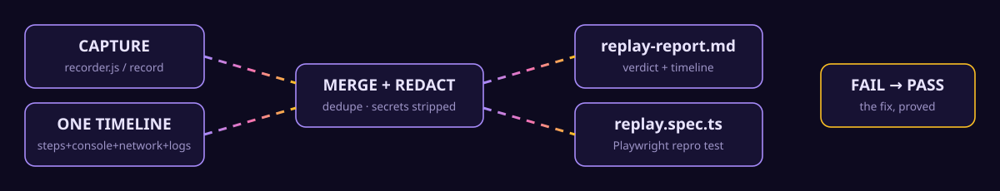

<div align="center">




<br/>

[](replay.py)
[](#-guarantees)
[](#-use-it-from-an-agent)
[](#-tests)
[](LICENSE)

</div>

A user reports a bug in one sentence — *"I clicked pay and nothing
happened"* — and the AI agent was not there. It never saw the steps,
the console, or the failed request. So it guesses, patches the wrong
thing, and cannot prove the fix.

`replay-cli` captures the bug **once** and turns it into two things
any agent can use: a **report** (steps, console, network and logs on
ONE timeline, deduplicated, secrets redacted, with a verdict) and a
**Playwright test** generated from the captured steps that FAILs
before the fix and PASSes after it. *Cannot reproduce* stops being
an answer.


## 🛡️ Guarantees

- **Secrets never survive load.** `Authorization`, `Cookie`, and
  token/password/secret values are redacted from every field before
  anything is written — report and generated spec included. (The
  planted-bug fixture carries fake secrets; the tests assert they
  appear in NO output.)
- **Stdlib-only core.** No pip installs, no API keys. Playwright is
  used by `record` only if it is already installed; without it,
  `record` is an honest **SKIP** (exit 2) — never a fabricated
  capture.
- **Machine-checkable verdict.** `replay check` exits **0** =
  ALL EXPECTATIONS PASS, **1** = BUG REPRODUCED, **2** = bad capture
  or SKIP. A 1 never gets softened into "probably fixed".


## 🚀 Quick start

```bash
# 1. get a capture: paste recorder.js into the buggy page (DevTools
#    console), reproduce the bug, save capture.json — or, with
#    Playwright installed:
python3 replay.py record https://your-site.com/checkout --out .

# 2. read the story of the bug
python3 replay.py report capture.json --out .   # → replay-report.md + replay.spec.ts
python3 replay.py check capture.json             # → BUG REPRODUCED, exit 1

# 3. fix, then prove it
npx playwright test replay.spec.ts               # must PASS now
python3 replay.py check capture-fixed.json       # → ALL EXPECTATIONS PASS, exit 0
```


## ⚙️ How it works

<div align="center">

</div>

## 📋 Capture format

```json
{
  "url": "https://shop.example.com/checkout",
  "steps":   [{"t": 1.2, "type": "click", "selector": "#pay-button", "text": "Pay now"}],
  "console": [{"t": 2.1, "level": "error", "text": "Payment failed: 403"}],
  "network": [{"t": 2.0, "method": "POST", "url": "https://shop.example.com/api/pay",
               "status": 403, "expected_status": 200}],
  "logs":    [{"t": 2.0, "text": "POST /api/pay -> 403"}]
}
```

`t` is seconds since capture start. A network entry with
`expected_status` must match it; any status ≥ 400 without a matching
expectation fails; console errors fail unless the capture sets
`expect_no_console_errors: false`. Repeated console/network events
are deduplicated (`×N`). Full spec: [SPEC.md](SPEC.md).

## 📋 Example report (planted-bug fixture, excerpt)

```markdown
## Verdict: BUG REPRODUCED

## Failed expectations
- console error at t=2.1s: Payment failed: 403 Forbidden
- POST https://shop.example.com/api/pay returned 403, expected 200 (t=2.0s)

## Timeline
| t (s) | Kind | Event |
|---|---|---|
| 1.2 | step | click #pay-button |
| 2.0 | network | POST https://shop.example.com/api/pay -> 403 ❌ |
| 2.1 | console/error | Payment failed: 403 Forbidden (×3) ❌ |
```


## 🤖 Use it from an agent

**MCP (stdio)** — two tools, `replay_report` and `replay_check`
(each takes `capture_path` or a `capture` object):

```bash
python3 replay.py mcp
```

```json
{ "command": "python3", "args": ["/path/to/replay.py", "mcp"] }
```

**Skill** — see [SKILL.md](SKILL.md): *never guess at a bug you have
not replayed; never report a bug fixed without a passing replay.*

**Manual recording** — see [recorder.js](recorder.js): paste it into
any page, reproduce the bug, download `capture.json`.


## 🧪 Tests

```bash
python3 -m unittest   # 14 tests, incl. the planted-bug acceptance tests
```

The suite covers the fixtures in `fixtures/`: the **planted bug**
(pay click → `POST /api/pay` 403 vs expected 200 + console error →
must FAIL, naming the 403), the **fixed** version of the same capture
(200 → must PASS), a **healthy** capture (must PASS), secret redaction
(fake Authorization/Cookie/token values must appear nowhere), and the
honest-SKIP `record` path when Playwright is absent.

Real-project evidence: [`real-project-report-keyscope.md`](real-project-report-keyscope.md) —
KeyScope served locally; `record` honestly SKIPPED (Playwright not
installed — stated in the file, not hidden), and the report was built
from a capture assembled from a real HTTP fetch of the page (real
URL, real 200, real title).

## 🗺️ Roadmap

- v0.2: record full steps (clicks/fills) in `record` via Playwright,
  screenshots on failure steps, `--json` verdict output
- Later: HAR import, GitHub Issue from a report, CI action

## 📄 License

MIT — see [LICENSE](LICENSE).

<div align="center">

</div>
